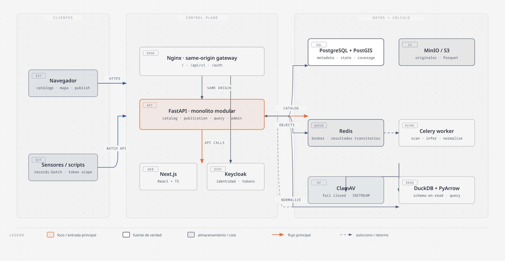
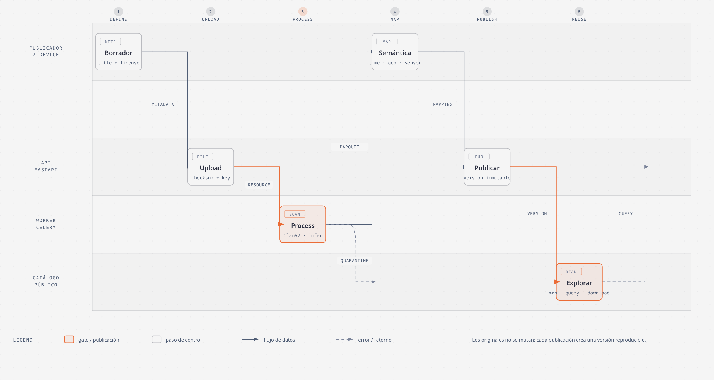

<div align="center">

# OpenIoTData

**Catálogo abierto para publicar, descubrir y reutilizar datos heterogéneos de sensores IoT.**

<a href="https://github.com/AndresPescador/OpenIoTData/actions/workflows/ci.yml?query=branch%3Amain"></a>
<br>
<sub>Beta local · Apache License 2.0 · FastAPI + Next.js + PostgreSQL/PostGIS</sub>

<br><br>

<a href="#inicio-rápido">Inicio rápido</a> ·
<a href="#tecnologías">Tecnologías</a> ·
<a href="#arquitectura">Arquitectura</a> ·
<a href="docs/API.md">API</a> ·
<a href="docs/HANDOFF.md">Handoff</a> ·
<a href="docs/ROADMAP.md">Roadmap</a> ·
<a href="CONTRIBUTING.md">Contribuir</a> ·
<a href="LICENSE">Licencia</a>

</div>

> Este repositorio contiene una beta funcional para desarrollo local. Los datos de demostración son ilustrativos: no representan mediciones verificadas ni una validación científica.

## Qué ofrece

| Capacidad | Resultado |
|---|---|
| Publicación reproducible | Carga CSV, TSV, JSON, NDJSON, Parquet o GeoJSON; el original se conserva y se genera un derivado Parquet. |
| Catálogo público | Descubrimiento, filtros, paginación, fichas de dataset y consulta segura sin exponer SQL libre. |
| Geografía y series temporales | Mapeo de tiempo, sensor y coordenadas; cobertura PostGIS, puntos y visualizaciones. |
| Reutilización | Previsualización, consulta parametrizada, mapa y descarga versionada del original o normalizado. |
| Ingesta continua | Lotes append-only con tokens limitados por dataset e `Idempotency-Key`, disponible mediante API. |

## Inicio rápido

Requisitos:

- Docker Engine 24+ y Docker Compose v2.20+.
- Aproximadamente 10–12 GB de RAM disponibles; ClamAV reserva hasta 3 GB porque cargar y actualizar firmas produce picos importantes.
- Python 3.12 y Node.js 22 para la puerta de calidad local.
- `curl` y `make` para los comandos auxiliares; `jq` y `sha256sum` para `make e2e`.
- Chromium de Playwright, instalable una vez con `make setup-e2e`.

Arranque completo:

```bash
cp .env.example .env
make bootstrap
```

`make bootstrap` valida Compose, construye las imágenes, espera los healthchecks, aplica las migraciones desde el arranque de `api`, ejecuta el seed idempotente y verifica los endpoints. La primera ejecución puede tardar varios minutos mientras ClamAV descarga o carga sus firmas.

Abra [http://openiotdata.localhost:8080](http://openiotdata.localhost:8080). Si el navegador no resuelve subdominios `.localhost`, use [http://localhost:8080](http://localhost:8080); Keycloak seguirá anunciando el issuer canónico `openiotdata.localhost`.

Para el registro/inicio de sesión del E2E, mantenga el hostname canónico o defina `PLAYWRIGHT_BASE_URL` a una URL que comparta ese origen con Keycloak, ya que las cookies OIDC son same-origin.

Comandos habituales:

```bash
make up       # construir e iniciar
make wait     # esperar servicios saludables
make seed     # recargar datos ilustrativos, sin duplicarlos
make check    # comprobar Compose y endpoints
make e2e      # publicar/consultar/descargar un dataset temporal y archivarlo
make e2e-ui   # probar el recorrido crítico desde Chromium y móvil
make setup-e2e # instalar Chromium de Playwright
make validate-beta # ejecutar la validación integral y la salud final
make verify   # lint, tipos, pruebas, build y configuración
make logs     # seguir logs
make down     # detener sin borrar volúmenes
make backup   # exportar PostgreSQL y objetos

make dev-run   # preparar y arrancar todo el modo host con un comando
make dev-seed  # cargar datos en la base del modo host (sin Docker)
make dev-api   # arrancar la API en el host (sin Docker)
make dev-web   # arrancar el frontend en el host (sin Docker)
make dev       # mostrar la configuración y la guía del modo host
```

No use `docker compose down -v` salvo que quiera eliminar de forma irreversible la base de datos, los objetos y las firmas locales.

## Tecnologías

<table>
  <tr>
    <th align="center">Experiencia</th>
    <th align="center">Plano de control</th>
    <th align="center">Datos y cálculo</th>
    <th align="center">Runtime local</th>
  </tr>
  <tr valign="top">
    <td align="center">
      <a href="https://nextjs.org/"></a><br>
      <sub>Next.js · React + TypeScript</sub>
    </td>
    <td align="center">
      <a href="https://fastapi.tiangolo.com/"></a><br>
      <sub>FastAPI · API modular</sub><br><br>
      <a href="https://www.keycloak.org/"></a><br>
      <sub>Keycloak · OIDC</sub>
    </td>
    <td align="center">
      <a href="https://www.postgresql.org/"></a><br>
      <sub>PostgreSQL + PostGIS</sub><br><br>
      <a href="https://redis.io/"></a>
      <a href="https://docs.celeryq.dev/"></a><br>
      <sub>Redis · Celery</sub><br><br>
      <a href="https://min.io/"></a>
      <a href="https://duckdb.org/"></a>
      <a href="https://arrow.apache.org/"></a><br>
      <sub>MinIO · DuckDB · PyArrow</sub><br><br>
      <a href="https://github.com/Cisco-Talos/clamav"><strong>ClamAV</strong></a><br>
      <sub>antivirus fail-closed</sub>
    </td>
    <td align="center">
      <a href="https://www.docker.com/"></a><br>
      <sub>Docker Compose</sub><br><br>
      <a href="https://nginx.org/"></a><br>
      <sub>NGINX · same-origin gateway</sub>
    </td>
  </tr>
</table>

Las fuentes, versiones y atribuciones de los SVG están documentadas en [docs/assets/technologies/README.md](docs/assets/technologies/README.md). Las marcas pertenecen a sus titulares.

## Arquitectura

<p align="center">
  <a href="docs/diagrams/openiotdata-architecture.html">
    
  </a>
</p>

La vista completa del diagrama se puede abrir en [HTML](docs/diagrams/openiotdata-architecture.html) o en la documentación de [arquitectura](docs/ARCHITECTURE.md).

OpenIoTData usa un monolito modular: una API mantiene catálogo, publicación, consulta, identidad y moderación; Celery separa el trabajo intensivo. Nginx sirve frontend, API e identidad bajo un mismo origen.

### Responsabilidad de cada almacenamiento

- **PostgreSQL/PostGIS:** datasets, versiones, recursos, campos inferidos, trabajos, permisos, auditoría y coberturas geográficas.
- **MinIO/S3:** originales inmutables, lotes NDJSON y derivados Parquet. El bucket es privado; la API entrega URLs temporales firmadas.
- **Redis:** cola y resultados transitorios de Celery, no fuente de verdad.
- **DuckDB/PyArrow:** inferencia, normalización y consultas parametrizadas sobre Parquet. No se acepta SQL del usuario.

No se crea una tabla SQL por dataset. El motivo y sus consecuencias están registrados en [ADR-0002](docs/adr/0002-schema-on-read.md).

## Flujo de publicación

<p align="center">
  <a href="docs/diagrams/openiotdata-ingestion-flow.html">
    
  </a>
</p>

La vista completa del flujo está disponible en [HTML](docs/diagrams/openiotdata-ingestion-flow.html); sus límites y dependencias se explican en la documentación de [arquitectura](docs/ARCHITECTURE.md). Los originales no se mutan; cada publicación crea una versión reproducible.

1. El publicador inicia sesión en Keycloak desde el frontend mediante OIDC Authorization Code + PKCE. El recorrido reproducible por `curl` de [docs/API.md](docs/API.md) usa password grant exclusivamente como atajo local; no representa el flujo del navegador ni debe habilitarse en producción.
2. Crea un borrador con título, descripción y metadatos mínimos.
3. Sube CSV, TSV, JSON, NDJSON, Parquet o GeoJSON. Para archivos grandes se solicita una URL firmada y se confirma el checksum SHA-256.
4. ClamAV examina el recurso; el worker infiere campos, calcula estadísticas limitadas y normaliza a Parquet.
5. Revisa el esquema y, si aplica, mapea tiempo, latitud, longitud, sensor, variables y unidades.
6. La publicación exige que el dataset tenga una licencia declarada y que todos los recursos estén listos. La versión publicada queda inmutable; el modelo actual no guarda una licencia independiente por versión.
7. Cualquier visitante puede buscar, previsualizar, consultar, ubicar en el mapa y descargar.

La interfaz REST detallada está en [docs/API.md](docs/API.md) y el recorrido con `curl` en [docs/INGESTION.md](docs/INGESTION.md).

## Servicios y puertos locales

| Servicio | URL o puerto | Acceso |
|---|---:|---|
| Aplicación vía Nginx | `http://localhost:8080` | Público local |
| Frontend directo | `http://localhost:3000` | Sólo diagnóstico |
| API directa | `http://localhost:8000` | Sólo diagnóstico |
| OpenAPI | `http://localhost:8000/api/v1/docs` | Público local |
| Keycloak | `http://openiotdata.localhost:8080/auth` | Mismo origen |
| Consola MinIO | `http://localhost:9001` | Administrador local |
| API MinIO | `http://localhost:9000` | URLs firmadas/local |
| PostgreSQL/PostGIS | `127.0.0.1:5432` | Administrador local |
| Redis | `127.0.0.1:6379` | Administrador local |
| ClamAV | `127.0.0.1:3310` | Administrador local |

Todos los puertos salvo el proxy web están ligados a `127.0.0.1`. La comunicación de la aplicación usa una red de datos interna; PostgreSQL, Redis y MinIO reciben además una red `diagnostics` exclusivamente para que Docker publique esos puertos en el host local. ClamAV usa una red separada para actualizar firmas. En producción deben retirarse tanto `diagnostics` como los puertos administrativos.

### Credenciales exclusivamente demo

| Uso | Usuario | Contraseña |
|---|---|---|
| Publicador Keycloak | `demo.publisher` | `publisher-local-only` |
| Moderador Keycloak | `demo.moderator` | `moderator-local-only` |
| Administrador Keycloak | `admin` | `admin-local-only` |
| MinIO | `openiotdata` | `openiotdata-minio-local-only` |
| PostgreSQL | `openiotdata` | `openiotdata-local-only` |

Estas credenciales se importan para facilitar el desarrollo. Nunca deben reutilizarse en una red compartida o producción. Cambie todos los valores de `.env`; no suba ese archivo al repositorio. `DEV_AUTH_BYPASS` permanece en `false` en Compose y la API prohíbe activarlo fuera de `development` o `test`.

## Ingesta continua por API

Un propietario crea un token limitado al dataset con el scope `records:write`. Luego envía lotes append-only a:

```text
POST /api/v1/datasets/{dataset_id}/records:batch
```

Cada observación exige `observed_at` y un objeto libre `data`; `sensor_id`, `location` GeoJSON y `metadata` son opcionales. Cada solicitud requiere `Idempotency-Key`, acepta como máximo 10.000 registros o 10 MiB y devuelve `202 Accepted`. Repetir la misma clave para el mismo dataset devuelve el trabajo existente sin duplicar datos.

La interfaz de gestión permite crear nuevas versiones, cargar recursos y publicar
snapshots, emitir/listar/revocar tokens de ingesta y archivar datasets propios. El
secreto de un token se muestra sólo al crearlo. Las cuentas con rol `moderator` o
`admin` pueden revisar y resolver reportes en `/admin`; los reportes comunitarios se
crean mediante la API.

## Desarrollo sin Docker para la aplicación

La infraestructura puede seguir en contenedores mientras API y frontend se ejecutan en el host.

Backend:

```bash
python3.12 -m venv backend/.venv
backend/.venv/bin/pip install -r backend/requirements-dev.lock
cd backend
.venv/bin/alembic upgrade head
.venv/bin/uvicorn app.main:app --reload --port 8000
```

Frontend:

```bash
cd frontend
npm install
NEXT_PUBLIC_API_URL=/api/v1 NEXT_PUBLIC_DEMO_MODE=false npm run dev
```

El modo demo es explícito. Para abrir el frontend sin API y con datos ilustrativos, use `cd frontend && npm run dev:demo`; nunca se debe usar ese modo para verificar la disponibilidad del backend. En el flujo normal, `NEXT_PUBLIC_DEMO_MODE` debe permanecer en `false` y los errores de la API se muestran al usuario.

Si se activa en Compose para una comprobación aislada, reconstruya `frontend` para que la variable pública quede incluida en el bundle:

```bash
NEXT_PUBLIC_DEMO_MODE=true docker compose build frontend
```

La pantalla de inicio de sesión de Keycloak permite crear una cuenta local mediante “Crear cuenta”. Las cuentas locales pueden publicar datasets y el catálogo sigue siendo anónimo para lectura.

Para el proxy de mismo origen, use la pila Compose. El frontend compilado recibe `NEXT_PUBLIC_API_URL=/api/v1`; Nginx conserva la URI al enviarla a FastAPI, por lo que nunca se duplica `/api/v1`.

## Modo host sin Docker (backend y frontend)

Para trabajar únicamente en la API y la interfaz, sin levantar la infraestructura, el
repositorio incluye un modo host con base SQLite, almacenamiento local y procesamiento
en línea. Sirve para desarrollar y depurar; no sustituye a `make validate-beta`.

Con un solo comando (Windows, macOS y Linux):

```bash
node scripts/dev.mjs
```

El lanzador crea `backend/.venv` e instala las dependencias cuando faltan, ejecuta
`npm ci` si no hay `node_modules`, carga el catálogo ilustrativo y arranca la API y el
frontend en la misma terminal. Pulse Ctrl+C para detener ambos.

- API: http://localhost:8000 (Swagger en `/api/v1/docs`)
- UI: http://localhost:3000

Opciones: `--api-only`, `--web-only`, `--no-seed`, `--reset`, `--env` y `--help`.

Requisitos: Python 3.12 o superior y Node.js 22. No se necesita Docker, `make` ni bash;
en Windows el lanzador funciona directamente con `node`.

Pasos manuales en Linux o macOS:

```bash
python3.12 -m venv backend/.venv
backend/.venv/bin/pip install -r backend/requirements.lock
cd frontend && npm ci && cd ..
make dev-seed   # carga el catálogo ilustrativo en la base local
make dev-api    # FastAPI en http://localhost:8000
```

En otra terminal:

```bash
make dev-web    # Next.js en http://localhost:3000
```

`make dev` muestra la configuración resuelta y `make dev-run` es el equivalente Unix del
lanzador. Para eliminar la base local y los objetos del modo host use `make dev-reset`
o `node scripts/dev.mjs --reset`.

Los valores están en `scripts/dev-local.env` (SQLite en `backend/data/`, almacenamiento
local, `DEV_AUTH_BYPASS=true`). Acceda por `http://localhost:3000`; el modo demo del
frontend permanece desactivado.

El modo host omite deliberadamente ClamAV, Keycloak/OIDC, PostGIS y el worker Celery:
la identidad se simula con la cabecera `X-Dev-User` (roles `publisher` y `moderator`),
las consultas por `bbox` usan la envolvente almacenada en lugar de `ST_Intersects`, la
subida usa multipart (sin `presign`) y `DEV_AUTH_BYPASS` sigue prohibido fuera de
`development` y `test`. Para autenticación real, almacenamiento S3, antivirus, PostGIS
y validación integral, use la pila Compose.

## Pruebas locales

```bash
make lint
make test
make verify
make setup-e2e
make validate-beta
docker compose config --quiet
bash -n scripts/*.sh
```

`make test` ejecuta 27 pruebas backend y 16 frontend. Cada caso backend expira a los
60 segundos y produce un volcado de stacks a los 45 segundos. `make validate-beta`
es la puerta manual canónica: ejecuta calidad, arranque, repetición idempotente del
seed, salud, E2E API, E2E de navegador en escritorio/móvil y salud final. La evidencia se registra en
[`docs/VALIDATION.md`](docs/VALIDATION.md).

`make e2e-ui` necesita la pila levantada con `make bootstrap` y Chromium de Playwright instalado:

```bash
make setup-e2e
```

La pila local reserva aproximadamente 10–12 GB de RAM, principalmente por ClamAV.

## Seguridad y gobierno de datos

Las cargas son contenido hostil. En local, la API y el worker esperan a ClamAV saludable y `CLAMAV_REQUIRED=true`; fallan cerrados si el escaneo no está disponible. Además:

- extensiones y firmas de archivo permitidas, nombres internos generados y checksums;
- límites en el borde de 64 KiB para JSON general (incluido `query`), 10 MiB para lotes REST y 1 GiB para multipart, además de 20 GiB por cuenta;
- workers sin capacidades Linux, sistema de archivos de sólo lectura, temporales acotados y sin red externa;
- bucket privado, tokens API hasheados y revocables, versiones inmutables y auditoría;
- CORS explícito, rate limiting y cabeceras de seguridad en API/Nginx;
- reducción de precisión disponible para ubicaciones sensibles;
- licencia de dataset obligatoria y canal de reporte comunitario.

La CSP local permite scripts inline por el arranque de Next.js. En producción debe sustituirse por nonces/hashes. Consulte [SECURITY.md](SECURITY.md) y la [política de publicación](docs/DATASET_POLICY.md).

## Respaldos y recuperación

```bash
make backup
```

El comando crea `backups/<fecha-UTC>/postgres.dump`, una copia lógica del bucket en `minio/`, un manifiesto y `SHA256SUMS`. `backups/` está ignorado por Git, pero puede contener información sensible y debe cifrarse fuera del equipo.

Compruebe un respaldo:

```bash
cd backups/20260823T120000Z
sha256sum --check SHA256SUMS
```

Pruebe la recuperación en una instancia separada, nunca sobre la única copia:

```bash
createdb -h 127.0.0.1 -U openiotdata openiotdata_restore
pg_restore -h 127.0.0.1 -U openiotdata -d openiotdata_restore --no-owner postgres.dump
```

Los objetos pueden restaurarse con `mc mirror` hacia un bucket vacío. PostgreSQL y MinIO forman una sola unidad lógica: restaure ambos desde el mismo corte. Defina RPO/RTO, cifrado, retención y pruebas periódicas antes de producción.

## Paso a producción

La configuración Compose es deliberadamente local. Antes de publicar en Internet:

- fijar imágenes por digest y generar SBOM/escaneo de dependencias;
- usar TLS, dominio real, cookies seguras y una CSP con nonce; retirar puertos administrativos;
- usar secretos administrados, rotarlos y eliminar usuarios/credenciales demo;
- ejecutar Keycloak con `start`, una base aislada, correo verificado, MFA para moderadores y protección de fuerza bruta revisada;
- usar PostgreSQL/PostGIS y S3 administrados o con alta disponibilidad, cifrado, versionado y políticas de ciclo de vida;
- autenticar/cifrar Redis, separar cola de resultados y limitar egress del worker;
- ejecutar migraciones como job único, no al arrancar cada réplica;
- aislar procesadores de archivos con límites de CPU, memoria, tiempo y red; mantener ClamAV actualizado;
- centralizar logs, métricas y trazas; alertar por errores de ingesta, cola, cuota, latencia y almacenamiento;
- sustituir el rate limiter en memoria por uno distribuido y probar carga, recuperación y moderación;
- revisar privacidad, términos, eliminación legal y publicación de coordenadas sensibles.

La transición a ClickHouse, Trino o tiles vectoriales sólo se justifica con datos de volumen y concurrencia. La API pública debe mantenerse estable al cambiar el motor.

## Estructura

```text
backend/                 FastAPI, modelos, workers y migraciones
frontend/                Next.js y experiencia del catálogo
infra/                   Nginx, realm Keycloak e inicialización PostGIS
scripts/                 bootstrap, seed, checks y backups
docs/                    API, ingesta, handoff, roadmap, validación, políticas y ADR
docker-compose.yml       pila local completa
```

## Contribuir y licencias

Consulte [CONTRIBUTING.md](CONTRIBUTING.md) y [CODE_OF_CONDUCT.md](CODE_OF_CONDUCT.md). El código se distribuye bajo [Apache License 2.0](LICENSE). Esa licencia no se aplica automáticamente a los datasets: cada publicador debe escoger y declarar una licencia de datos compatible con sus derechos.
